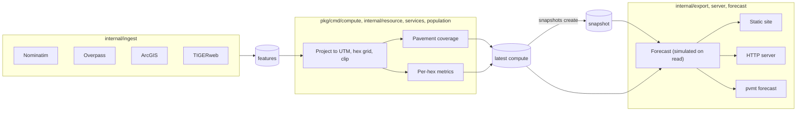
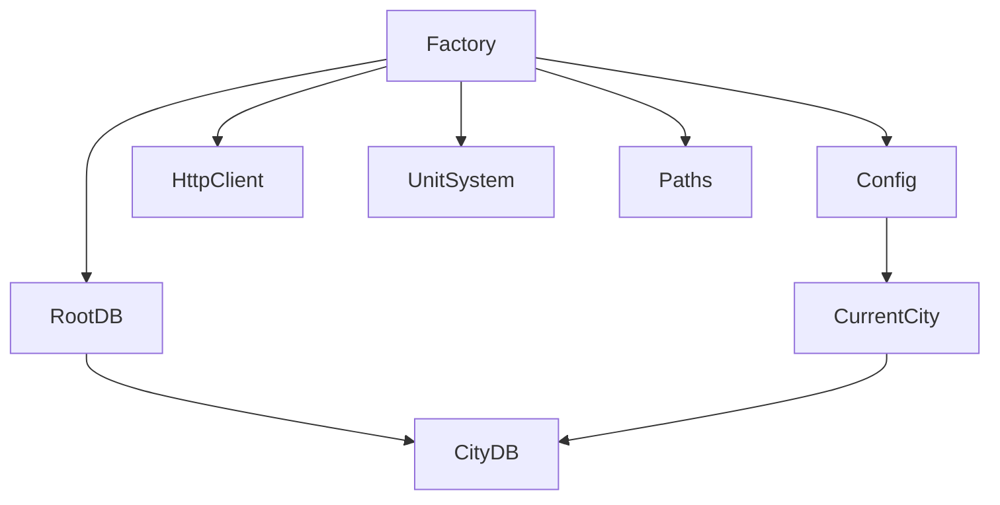
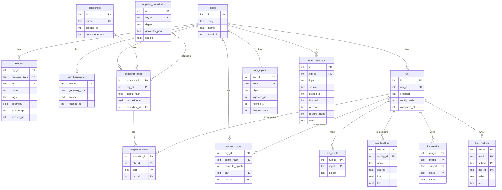

# Architecture

`pvmt` is a pipeline with a database in the middle. **Ingest** fetches
features for each configured city from upstream services and stores them.
**Compute** projects those features onto a hex grid, and each producer stores
its results as an immutable *run* in the city's *latest compute*.
`pvmt snapshots create <name>` freezes every city's latest compute into one
named *snapshot*, and **publish** commands, export and serve, read each city
from the newest snapshot (or the one `--snapshot` names).
`pvmt forecast` reads the latest compute. Every reader simulates the forecast
when it runs, so nothing forecast-related is ever stored. This page explains how each stage is built and why. What the models
*mean* (decay, cost, solvency, fire response, population) is in the
[methodology](methodology.md), and every setting is in
[configuration.md](configuration.md).

## Commands and the Factory

Commands follow the `gh` CLI's shape: each has an Options struct, a
constructor and a `Run` function. Each receives a `*cmdutil.Factory`, and tests
swap in a `runF` to capture the options. The Factory holds lazy
`sync.OnceValues` accessors, so a command pays only for what it touches:
`--version` opens no config and no database. `IOStreams`, `Prompter` and
`Logger` are the eager exceptions, because they are cheap to build.

The root command wraps the Factory's `CurrentCity` and `UnitSystem` accessors
with the `--city/-c` and `--units` flags (`cmdutil.AddCityOverride`,
`wireUnitSystem`), so a flag beats per-city and top-level config when the
accessor is first read. `PersistentPreRunE` sets only the log level. Multi-city commands iterate with `cmdutil.ForEachCity`, which builds a
city-scoped Factory per city.

## Geometry

All area math happens in projected meters, never in degrees. Each city is
projected to the UTM zone of its bbox centre. A road centerline is buffered by
a width inferred from its OSM tags: the `width` tag, else `lanes`, else a
class default, plus any parking lanes. Sidewalks are buffered the same way
with their own defaults. Parking lots are already polygons. Buffered
geometries go into an R-tree. The city is tiled with flat-top hexes of the
configured edge and clipped to the city boundary. For each hex, the features
it touches are unioned and clipped to the hex, which gives its paved area
(`paved_area`, m²) and the paved proportion of the hex (`paved_share`, 0..1).
Hex polygons are
projected back to WGS84 only for output.

Geometry is pure Go, `peterstace/simplefeatures`. Several of its constructors
have non-obvious signatures (`NewLineString` returns one value,
`Envelope.MinMaxXYs()` returns `(XY, XY, bool)`), so mirror the existing
`internal/geo/` call sites rather than guessing.

Large Overpass queries split into quadrants, up to depth 3 (64 requests), and
deduplicate features at the seams.

## Per-hex metrics

Every per-hex value is a row of `hex_metrics`, and every city-wide one a row
of `city_metrics`: a metric, the subject it is measured over, and the value.
Every metric key, stored or derived, is declared once in the metric catalog
(`internal/metric`) with its unit, the level it lives at (city, hex, both, or
derived by the dashboard) and what it means. Registration enforces the
naming rule of [JSON conventions](#json-conventions), and
`SaveCityMetrics` / `SaveHexMetrics` refuse a key the catalog does not store
at that level. The key is the name the measure has everywhere: in the
database, `hex-metrics.json`, `meta.json`'s `metrics`, the page config's
`hex_metrics`, `?metric=` and `pvmt snapshots diff`.

Pavement coverage is just more metric keys (`paved_area`, `paved_share`, and
`parking_spaces` for parking) over a resource subject (`roads`,
`roads:city`, ...); `internal/results` maps the pavement compute onto those
rows. `internal/hexmetric` is presentation only: a Spec names a catalog key
and adds the label, format, colour scale and, for a derived metric, how the
dashboard computes it. Every other per-hex metric has subject `""`. Two
producers write them:

- **Fire response.** `internal/services` routes from fire stations over a
  graph built from the stored roads. A hex on the road network that no
  station reaches gets a row under subject `unreachable`
  (`services.SubjectUnreachable`) instead of a time; its value carries
  nothing. The exporter counts those rows against the within-threshold
  share and leaves the hexes out of `hex-metrics.json`.
- **Population.** `internal/population` apportions 2020 Census blocks onto
  hexes by area.

The pavement keys are stored per hex like any catalog metric, under a
resource subject, but `internal/hexmetric` registers them as derived
colorings rather than shipping them in `hex-metrics.json`: the exporter folds
coverage and parking spaces into `hexgrid.geojson`, and the dashboard derives
their colorings from there. The roads compute also stores
`default_decay_rate` under `roads:city`: each city road hex's blend of its
road classes' decay rates, weighted by in-hex class area, at no `decay_rate`
override. It comes from the per-hex class areas the cohort split already
clips, so it costs no extra pass. The exporter scales it by the override
(every road class scales linearly, so the blend does too) and writes it as
the hex's `k` in `hexgrid.geojson`. The `/play` board reads its hexes from
that file: the features carrying `k`, with the city-scope roads area. Export
never reads road features.

Both metric producers resolve, through `compute.LoadMetricTarget`
(`pkg/cmd/compute`), the same projection and clipped grid the pavement passes
use, so hex ids line up. No producer reads another producer's stored results.

The dashboard paints every coloring from the `internal/hexmetric` registry. Stored metrics ship in
`hex-metrics.json`. *Derived* metrics are registered beside
them under the key of the measure they compute: % Paved
(`maintained_share`) and maintained area (`maintained_area`), the stored
`paved_share` and `paved_area` summed over the toggled resources; parking
spaces (`parking_spaces`); and year-1 need (`year1_need`) in
`internal/hexmetric/builtin.go`, and the per-resident ratios in
`internal/population`. Each declares how to combine the per-resource values in
`hexgrid.geojson`, and the browser resolves it. A spec's `Source` is its
one-line definition for readers: the legend shows it under the title. A new
coloring is therefore a registry entry, plus a producer if it needs stored
data, and no client code.
`hexgrid.geojson` carries every hex of the clipped grid the export draws,
pavement or not, so a stored metric can paint a hex that has no pavement. The
drawn grid is not quite the one the producers computed on: the export drops
edge and shoreline slivers below `min_hex_area`, a presentation setting, so
the pavement totals stay whole while the map shows no misleading sliver.
`hex-metrics.json` and the per-metric summaries in `meta.json` cover exactly
the drawn hexes (`export.DrawnGrid`): a stored row whose hex the map does not
draw is in neither, so the stats panel counts only what the map can paint.
The drawn grid encodes each hex's geometry once, and the hexgrid features and
the drawn id set both come from that, so they cannot disagree. It redraws the
lattice compute clipped with `geo.ClipHexesToBoundaryLocal`, which cuts each
straddling hex against a quadtree piece of the boundary rather than all of it:
the same hexes and shapes to rounding, in under a second where the whole-
boundary clip takes tens (Charlotte's boundary has 57,000 vertices). Compute
keeps `geo.ClipHexesToBoundary`, which its stored results are defined on. An
export builds one drawn grid per city for all three files, and `pvmt serve`
caches one per city and snapshot, shared by the three endpoints and the pages.

Fire stations and census blocks are *own-sourced* (`resource.OwnSourced`):
each comes from one fixed upstream, whatever the city's `overpass` /
`arcgis_url` settings. `ingest.SourcesFor` resolves the source, and `pvmt gc`'s
stale-source sweep covers only the pavement types in `resource.All`, so a new
own-sourced type needs no special case in either. A facility ingest also
fetches its *companion* (`resource.Companioned`), the routing roads
(public name `routing_roads`, stored as `routing-roads`; OSM only, never in `resource.All`), and both are fetched
over the boundary bbox padded by `resource.ServiceAreaPadM`
(`resource.FetchPadder`), so a station across the city line exists and the
graph reaches it. For a city whose roads come from Overpass, the routing roads
are only the ring outside the boundary bbox (`resource.ExcludingQuerier`, one
Overpass difference query): every road touching the bbox is already in the
city's own roads, which the services graph joins by way id. Pavement stays
unpadded, so its feature counts are those of the boundary bbox. TIGERweb and
the ArcGIS centerline source share one paging and completeness core,
`ingest.ArcGISQuery`.

## City boundary and water strip

Every ingest step starts from the city boundary: the stored one, or a fresh
one, fetched from `boundary_relation_id` via Overpass or by name from
Nominatim, with open water subtracted so that `% paved` compares land with
land. The city's roads are the strip's evidence of where the land is, so a
fresh boundary (`fetchBoundary`, `pkg/cmd/ingest`) is resolved in one pass
that saves nothing until it ends:

1. Fetch the unstripped boundary. Its bbox holds every boundary the strip
   can produce.
2. Fetch the roads over that bbox from every configured road source, and
   take their land probes (`ingest.RoadLandProbes`): each road's middle
   vertex inside the unstripped boundary, at most one per 0.001° cell,
   leaving out bridges, tunnels, piers, fords and the like. The probes come
   from the OSM roads whenever the city uses Overpass, and from ArcGIS only
   when it is the sole source, because ArcGIS centerlines carry no bridge
   tags. With fewer than 30 such roads (`ingest.RoadProbeMinCells`), the
   probes are the boundary's interior points, one per sub-polygon.
3. Fetch the OSM water (`ingest.FetchOSMWater`: `natural=water` ways and
   relations, and `natural=coastline` closed along the bbox), drop every
   candidate that holds more probes than a small allowance
   (`LandProbes.MaxHits`), since it covers the city's streets, and subtract
   the rest. Coastlines are judged as faces (`coastlineFaces`): every open
   coastline cuts the bbox along itself, so each landmass and each body of
   water is a face of its own, and a face holding more probes than the
   allowance is land. A water face with a few piers' roads beside a land
   face holding thousands is the one, warned-about, exception. A lake or river may be far larger than the city; only with the
   interior-point fallback, which is too sparse to catch a mis-tagged giant
   polygon, is a way or relation covering most of the bbox rejected. With
   roads, an island's closed coastline is land, a hole in the face around
   it, so an island city is cut to its islands.
   The water is clipped to the bbox before the subtract, so a Great Lake
   costs no more than a pond.
4. Check the result against the same roads (`chooseBoundary`): a strip that
   leaves too few of them inside is replaced by its complement, or else by
   the unstripped boundary.
5. Save the boundary, then the roads that touch its bbox. Those are the rows
   a fetch over that bbox stores, so the roads step reuses them, and the
   routing roads' ring still excludes exactly the city's own roads.

A failed roads or water fetch saves nothing, so the next ingest retries; for
a city that uses Overpass, a failed Overpass roads fetch counts as failed
even when ArcGIS answered.
`--rebuild-boundary` replays the pass through the HTTP cache; where an
earlier strip shrank the bbox, its first replay fetches the roads upstream.

## Database

The database is a single SQLite file in the data directory (see
[configuration.md](configuration.md#files-and-directories)), opened in WAL
mode. Every ingest table, and `runs`, `working_parts`, `snapshot_cities`,
`snapshot_parts` and `snapshot_boundaries`, carries a `city_id`; `snapshots`,
the named tag over many cities, does not. Results do not either:
each result row hangs off the run that wrote it and is deleted with it
(`ON DELETE CASCADE`), so a city's results are its runs' results. Results are
long-format metric rows (metric, subject, value) rather than per-measure
tables, so a new producer adds metric keys, not tables:

- `city_metrics` holds city-wide values: a resource's totals (class `""`) and
  its per-highway-class cohort split (class `primary`, `residential`, ...).
- `hex_metrics` holds per-hex values.

Both are keyed by run and measure, which makes each row write-once. The
metric keys and the subject convention are in `internal/resource/metric.go`.

Freshness is tracked by content, not by clock. `city_inputs` holds a digest
of each stored input: one per features `resource_type`, plus `boundary`. It
is a sha256 over the stored rows in id order (`internal/db/inputs.go`), or
`""` when there are none. `UpsertFeatures`, `SaveBoundary` and `GCSweep`
update it in the same transaction as the rows. `ingested_at` moves only when
the digest does, so re-ingesting identical data changes no digest. The same
pass over the rows keeps `fetched_at`, the newest fetch time among them
(`Stats.LastIngestAt`, what `status` and `cities` show), so that is a key
lookup rather than a scan of the type's rows, and `feature_count`, the number
of rows. Each run
records the digests it read in `run_inputs`. `db.ProducerInputs` is the one
statement of which inputs each producer reads, and the producer takes the
digests before it reads the data, so an ingest that lands mid-compute makes
the run look stale rather than current.

Features keep only their last successful fetch, so `ingest_attempts` keeps
the rest: one row per source an ingest asked, per input (`boundary` or a
`resource_type`), with its outcome (`ok`, `empty` or `failed`), its feature
count and, for a failure, the error. The ingest command records them after
the save, so a source whose rows could not be saved is recorded as failed.
The write is best-effort and never fails an ingest. A canceled request
leaves no row, and only the newest 20 rows per city, input and source are
kept. `Store.IngestHistory` reads each key's newest attempt, success and
failure. It is how a failed or partial ingest is told apart from a complete
one.

A service run also freezes what export draws its coverage with. It writes
the facilities it routed from (OSM points and `[[cities.facilities]]`) to
`run_facilities`. It also writes the turnout its times include as a
`city_metrics` row: metric `turnout_s`, subject `service:<name>`.
Export reads both back through the view (`Store.ListRunFacilities`,
`ListCityMetrics`), so the station markers, legend bands and covered line
stay those of the run that produced the colours. Later ingests and
`turnout_s` edits don't move them. Only `travel_threshold_s`, a
presentation setting, comes from the current config.

`cities` is unique on `(slug, config_id)`, not on slug alone. That keeps two
configs that happen to define the same city apart, while a city pulled in
through `[[include]]` resolves to its declaring config's row (see
[Config identity](configuration.md#config-identity-config_id)).

Every timestamp (`*_at`) is an `INTEGER` of unix seconds, UTC. Go writes each
one; the columns have no SQL default, so a statement that forgets one fails
rather than storing another format. Stored times therefore compare as numbers
(gc's `computed_at < cutoff`) and read back in UTC at second precision, the
form the CLI and JSON print. `internal/db/timestamps.go` holds the one pair of
conversions every bind and scan uses.

`features` is keyed `(city_id, resource_type, id)` and is `WITHOUT ROWID`, so
the rows live in the key's b-tree and the key is the table's only index. Every
statement against it names a city and a type, so each is a seek on the key's
prefix, which `TestQueryPlan_FeaturesStatements` pins:

| Statement | Where | Served by |
|---|---|---|
| upsert (`INSERT OR REPLACE`) | `UpsertFeatures` | the key; replaces by `(city, type, id)` |
| delete a type, or a type's sources | `UpsertFeatures` (replace) | key prefix, then a `source_api` filter |
| list a type | `ListFeatures` | key prefix |
| digest, count, newest `fetched_at` | `featuresDigest` | key prefix; `ORDER BY id` is key order |
| stale types, count, delete | `gc` (`staleFeatures`) | key prefix over the pavement types |

`Stats` reads no features: the count and newest fetch time come from
`city_inputs`, because `COUNT(*)` on a `WITHOUT ROWID` table reads every row
of the slice.
A `WITHOUT ROWID` b-tree keeps at most about 1 KB of a row on its leaf page
(at the default 4 KB page size) and spills the rest to an overflow page of its
own; only about 0.07% of rows are that large after TWKB (census blocks and a
few long roads, about 35 MB on the 16M-row release database), so the page size
stays the default.

A feature's `geometry` is [TWKB](https://github.com/TWKB/Specification/blob/master/twkb.md)
at 7 decimal places (1e-7 degrees, about 1 cm), about a sixth of the GeoJSON
text (`internal/db/geometry.go`). `UpsertFeatures` parses the GeoJSON without
validating it, since OSM holds invalid shapes such as self-intersecting
polygons that must come back as they went in, and `ListFeatures` hands back
GeoJSON again, so `db.Feature.GeometryJSON` and every reader are unchanged.
OSM coordinates (7 decimals) and TIGER's (6) read back as bit-identical
float64s, which the routing graph relies on when it joins vertices across
roads and routing roads by exact equality. ArcGIS layers serve 12 to 13
decimals, which are rounded to 7. Seven is TWKB's maximum (the header holds
the precision in 4 bits), so a source that needs finer coordinates would need
another encoding. Every ring is written with its closing point, so a closed
ring reads back exactly as written, a doubled closing vertex or a 2-point ring
included. A ring whose ends differ (open, or apart only in Z) keeps every
vertex but reads back closed: the TWKB reader appends its first point. GeoJSON
the store cannot parse fails the upsert; ArcGIS and TIGERweb rows that would
(`db.CheckGeometry`) are dropped at ingest with a warning, so one bad row does
not fail a layer. Rows are encoded before the write transaction begins, so
parsing never holds the write lock. The features digest hashes the decoded coordinates
(their WKB), not the stored bytes, so a change of encoding that reads back the
same coordinates keeps every input current. Tags, names, types and
sources stay JSON and text so the database stays readable with `sqlite3`;
boundaries stay GeoJSON.

The snapshot tables are keyed for the statements that read them, and
`TestQueryPlan_SnapshotStatements` pins each plan:

| Statement | Where | Served by |
|---|---|---|
| does snapshot S cover city C | a pinned view (`checkPin`) | `snapshot_cities` key |
| newest snapshot covering C | an unpinned view, export, serve | `idx_snapshot_cities_city (city_id, snapshot_id)`, read backwards |
| C's manifest in S | every pinned read (`viewRunIDs`) | `snapshot_parts` key prefix `(snapshot_id, city_id)` |
| S's frozen boundary for C | `GetBoundary` | `snapshot_cities` key |
| snapshot by name | create, show, delete, `?snapshot=` | `UNIQUE(name)` |
| is a run still in a snapshot | delete, gc | `idx_snapshot_parts_run` |
| is a boundary still frozen | delete, gc | `idx_snapshot_cities_boundary` |

Deleting a snapshot deletes its `snapshot_cities` and `snapshot_parts` rows by
`ON DELETE CASCADE`, through those keys' `snapshot_id` prefix.

`001_init.sql` creates the schema, and `checkGeneration`
(`internal/db/migrations.go`) stamps a fresh database's `PRAGMA user_version`
with `schemaGeneration`. Released migrations are immutable: `001_init.sql`
is the v0.5.0 baseline, and every schema change is a new numbered migration
(`002_*.sql`, ...) that `migrateFS` applies within the generation (see
[CONTRIBUTING.md](../CONTRIBUTING.md#schema-changes)). Rewriting a shipped
migration is a squash, which bumps the generation, and pvmt refuses a database from any other generation rather than
converting it (see [troubleshooting](troubleshooting.md#incompatible-database)).

## Runs and snapshots

A *run* is one producer's output for one city. The producers are the roads,
parking or sidewalks compute, the combined pass, `service:<name>` and census.
Every result row carries its `run_id`, and runs are immutable. Result rows
have no timestamp of their own: a row's time is its run's `computed_at`, set
when the run is created, so `status` and `snapshots list` show when a compute
began, not when it finished saving. The city's
*latest compute* under a config hash (`working_parts`) names one run per part:
the newest committed run of each producer. A *snapshot* is a named, immutable
tag over every configured city, like a git tag. `pvmt snapshots create
<name>` copies each city's latest compute into it (one `snapshot_cities` row
and its `snapshot_parts` manifest per city), and it never changes after that:
creating a name that exists is refused, and replacing a snapshot is `delete`
then `create`. Every city read resolves exactly one manifest and reads only
its runs: the city in a pinned snapshot (`Store.WithSnapshot`), the latest
compute under the city's current config hash (`Store.WithLatestCompute`, what
`cmdutil.PinnedCityStore` gives compute, status and forecast), or a latest
compute pinned as of one moment (`Store.WithRuns`).

`pvmt export` and `pvmt serve` publish each city from the newest snapshot
that covers it, whatever config hash the city was frozen under, or from the
snapshot `--snapshot NAME` names, and pin it once at startup, so a snapshot
created meanwhile cannot mix two into one city's files. Export pins every
city before writing anything, and before `--clean` (`export.PinNewest`,
`export.PinSnapshot`), and refuses the whole site when any city has none, or
when the named snapshot does not cover a configured city, listing each. It
warns about a city frozen under other settings than the current ones, and
exports it as created. Serve shows a city with no snapshot from its latest
compute, pinned at startup with `WithRuns`. `?snapshot=<name>` overrides the
pin per request, and `?snapshot=latest` shows the latest compute read at
startup (`CityEntry.Latest`), which `meta.json` marks `latest_compute`;
`meta.json`'s `snapshot` names the snapshot otherwise. No snapshot may be
named `latest`. A pinned view also reads the boundary its snapshot froze. If the
snapshot is deleted while pinned, or gc sweeps a pinned run, every read fails
with `db.ErrSnapshotGone` (checked before and after each read) rather than
reading as an empty city: export fails, and serve answers 410 and caches
nothing.

A snapshot also freezes what drawing its grid depends on: the hex edge it was
tiled at (`hex_edge_m`) and the boundary it was clipped to, stored once per
distinct boundary in `snapshot_boundaries`. Export and serve draw a snapshot
on that lattice (`CityEntry.HexEdge`, and the pinned `GetBoundary`), so any
snapshot renders as computed after a `hex_edge_m` edit or a boundary
re-ingest, `?snapshot=<name>` included. The Config tab shows each city's
snapshot edge. A service run freezes the facilities and turnout it used, so
markers and the legend follow the snapshot too.

Each command builds a `db.Draft` and commits it into the latest compute
(`Store.CommitLatest`): only the parts the command produced swap in.
`pvmt roads compute` replaces the roads part, and fire coverage, population
and the other parts carry over. `pvmt all compute` commits once per city,
covering all of its steps. A failed step leaves its part as it was. A replaced
run is not deleted at commit: once nothing references it, gc sweeps it.

A rerun that reaches nothing still commits, as an empty run. A producer with
nothing to work from drops its part. Either way the older result leaves the
latest compute. A commit that would not change the manifest writes nothing.

`pvmt snapshots create <name>` freezes every configured city's latest compute
as one snapshot (`RootStorer.CreateSnapshot`), after a coherence check of each
city, all or nothing: one refused city refuses the snapshot, every refusal is
listed, and nothing is written. Each run records, in
`run_inputs`, the digest of every input its producer reads
(`db.ProducerInputs`, read before the inputs themselves), and `city_inputs`
holds each input's current digest. `internal/coherence.Check` is a pure
function of the latest compute and those digests. It refuses a city when a
part recorded a digest that is no longer current, when there is no pavement
part, when pavement has no combined part, or when a pavement input is stored
with no part. It warns about a missing service or census part whose inputs
are stored. `pvmt status` shows the same comparison per part
(`coherence.PartStates`: `current`, `stale` or `not_computed`), footnotes a stale
combined total, and counts the parts the newest snapshot does not hold
(`db.UnsnapshottedParts`). The check runs inside the snapshot's IMMEDIATE transaction, so no
ingest lands between the check and the freeze. No city of a snapshot is ever
empty, and a city unchanged since the last snapshot is frozen with the same
runs, so a new snapshot of a mostly unchanged tree costs a few rows per city.
The snapshot records the `config.ComputeEpoch` of the pvmt that created it. `pvmt all compute` builds one grid from the
boundary for every step, so it pins the boundary digest it read before
building it on the draft (`Draft.PinInput`): a boundary ingest during the
compute then reads as stale.

Nothing carries across config hashes, because hex ids from another grid would
land on the wrong hexes: each hash has its own latest compute, and a snapshot
holds, per city, runs of one hash. Export keeps a defensive check that a snapshot holds a
pavement compute.

Uncommitted runs are invisible. A canceled or failed command discards its
runs, and `pvmt gc` sweeps any that neither a snapshot nor a latest compute
references once they are a day old
(`db.OrphanRunGrace`). The grace is that long because one city of `pvmt all
compute` can legitimately hold an uncommitted run for hours. Each latest
compute row records the `config.ComputeEpoch` that committed it. gc drops rows
from an older epoch, whose hash no config can produce again, and their runs
become orphans in the same pass. Another config's latest compute, from the
same epoch, is kept. Write
transactions take the lock up front (`_txlock=immediate`), and one that finds
another process holding it keeps retrying for up to two minutes
(`commitBusyBudget`), well past SQLite's five-second busy timeout. So two
commands writing at once wait for each other: a compute beside a long ingest
or `pvmt gc` saves its results once the other's transaction ends. No
producer reads
another's results, so two commands committing in either order each swap in
only their own parts. `pvmt snapshots prune --keep N` keeps the newest N
snapshots, so the published one always survives. It and `delete` delete
snapshots with their cities' manifests, then every run that neither a
surviving snapshot nor a latest compute references, and every frozen boundary
no snapshot uses. A run the latest compute still references stays, so
`delete v1` then `create v1` re-freezes it rather than recomputing.

`pvmt snapshots diff A B` compares two snapshots city by city, reading each
city through its store pinned to each snapshot: the pavement totals
(`results.LoadTotals`), and the census totals and fire coverage from
`export.MetricSummaries`, the summary behind the site's Map stats card (its
"Within 5:20" row). It compares results, not hexes: two snapshots at
different hex edges share no hex ids.

## Config hash

Latest computes and snapshots are keyed by `Config.CityHash`
(`internal/config/hash.go`). It is a
16-hex-character sha256 over a canonical encoding of only the resolved inputs
that change a stored result (`computeInputs`), plus a hand-bumped
`ComputeEpoch` for code changes. Resolved means defaults, `[[include]]`
flattening and env overrides are applied first. Because the hash depends only
on what a city resolves to, an included city hashes as its source config does
when both resolve the same inputs (see
[Config identity](configuration.md#config-identity-config_id)). When they
differ, `SourceDivergence` names the setting.

`TestComputeInputs_EveryFieldClassified` forces every new config field to be
classified. Which settings are in the hash is stated once, for users, in
[configuration.md](configuration.md#snapshots-and-the-config-hash). The rules
for contributors are in
[CONTRIBUTING.md](../CONTRIBUTING.md#changes-that-affect-stored-results).

## JSON conventions

Every JSON document pvmt emits shares one vocabulary, so a key reads the same
everywhere. That covers CLI `--json` output, the HTTP API, the exported site
files, `window.PVMT_CONFIG`, and the game and WASM payloads.

- Keys are `snake_case`, and a value has one name across every surface
  (forecast.json's `annual_need` is the CLI's `annual_need`). Enumerated
  values are `snake_case` too (`not_computed`).
- Timestamps end in `_at` and are RFC3339 UTC at second precision. Calendar
  dates end in `_date`.
- A plural noun is a collection. An integer count of entities ends in
  `_count`. A quantity in a unit keeps its noun (`parking_spaces`).
- Values are in canonical units, and the UI converts them for display:
  - areas in m², with no unit suffix;
  - money in dollars, with no unit suffix;
  - lengths in meters, suffixed `_m` (`hex_edge_m`);
  - durations in seconds, suffixed `_s`;
  - rates carry their unit (`cost_per_sqm`).
- Proportions are fractions in 0..1. A part-of-whole proportion ends in
  `_share`. Signed ratios (`funding_gap`, `snapshots diff`'s
  `relative_change`) keep plain names.
- Metric keys come from the metric catalog (`internal/metric`), which
  enforces these rules when a key is declared (see
  [Per-hex metrics](#per-hex-metrics)).
- Positions are `[lon, lat]`, and extents are `bbox:
  [west, south, east, north]` (GeoJSON order). `pvmt.toml` and the Go
  internals use Overpass's `[south, west, north, east]`, and the exporter
  reorders at the boundary.
- A city is named by its slug. An object that is a city (a `pvmt cities`
  row, a cities.json entry) holds it as `slug`; an object that belongs to
  a city (a compute row, meta.json) holds it as `city`. The display name is
  `name`.
- Elsewhere `name` is an identifier and `label` its display form: a
  scenario, a snapshot, a tag dimension, a cost tier.
- `resource_type` is a pavement resource (`roads`, `parking`,
  `sidewalks`). `layer` (`pvmt status --all`, `services status`,
  `census status`) is any stored input, so it also takes `boundary`, each
  service's stations (`fire_stations`), `routing_roads` and
  `census_blocks`. These are public names (`resource.Type.PublicName`); the
  database keeps its own hyphenated ids.
- A value that does not apply is omitted, never `null` or a 0 sentinel.
- Scope values are `"city"` (city-maintained) and `"all"` (every
  jurisdiction). A value per scope is an object keyed by scope
  (`{"all": ..., "city": ...}`), or a pair of keys where the bare one is
  `all` and the `city_` one is city-maintained (`baseline` and
  `city_baseline`, `cohorts` and `city_cohorts`). The prefix means a scope
  only beside a bare partner: `city_area` (the boundary's land area) and
  `city_count` are not scoped values.
- A versioned data file carries its format version as `v`
  (`hexgrid.geojson`, `hex-metrics.json`, `compare.json`). The page config
  names the version the page reads as `hexgrid_version`,
  `hex_metrics_version` and `compare_version`, and `pvmt check-site`
  fails a file at another.
- An error is `{"error": "<message>"}`: from the `pvmt serve` `/api/`
  endpoints and from every WASM export. The `/data/` files keep plain-text
  errors, like the static host they stand in for.

A few formats are exempt:

- upstream formats;
- HTTP cache entries;
- `pvmt.toml` keys;
- `pkg/cmd/validate/reference.json`;
- the deliberately short per-hex keys in the large hexgrid (`area`,
  `share`, `spaces`, `city_same`, `k`).

`TestJSONTagsSnakeCase` and `TestJSONFields_SnakeCase` enforce the
conventions.

A command that prints rows takes `--json <field,...>`
(`cmdutil.AddJSONFlags`) and prints an array of row objects. A command that
prints one document takes a bare `--json` (`cmdutil.AddDocumentJSONFlags`):
export's manifest, validate's report and cache prune's report. `--jq` and `--template` need `--json`
and see exactly what it prints. `--jq` runs once over the whole output, and
`--template` runs once per row, or once over the document.

## Design decisions

**Metric internals.** Areas are stored in square meters and money in dollars.
`--units` and `[display].units` change presentation only.

**Embedded WASM.** The forecast runs in the browser as the same Go forecast
code compiled to WASM (`cmd/wasm/pvmt`), so the site and the CLI run one
model. The binary embeds it from `internal/export/wasm/`, whose only
tracked file is a README, so a build without the generated WASM still
compiles. That keeps `go install` working, at the cost of the commands that
ship the forecast (see
[troubleshooting](troubleshooting.md#export-errnowasm)). The build order is in
[CONTRIBUTING.md](../CONTRIBUTING.md#build-test-lint).

**Outbound HTTP cache.** Upstream responses are disk-cached in the cache
directory, one `<key>.json.gz` (the gzip-compressed body) and `<key>.meta` per
request, and served for `[cache] ttl` (`cache.DefaultTTL` when unset; why
the default is long is in [configuration](configuration.md#http-cache-cache)).
Overpass POSTs are cached too, because the key folds in
the method, the full URL and the body. A configured Overpass endpoint therefore
gets entries of its own, and the default endpoint's URL is a pinned constant so
its entries keep matching. A `200` whose body is over the 100 MiB response cap (New
York's roads over its whole bbox) is not cached; a `<key>.toolarge` marker
records it instead, for the TTL, and the request then fails at once as too
large without asking upstream, so the Overpass fetch splits straight to its
quadrants, which are cached (`--force` ignores the marker). The cache has no online eviction: a directory scan in
front of every request would cost more than it saves. Eviction is the
explicit offline sweep `pvmt cache prune` (see
[troubleshooting](troubleshooting.md#disk-usage-the-http-cache-keeps-growing)).
It is a command group of its own rather than part of `pvmt gc`, because
reclaiming disk must not depend on the config or the database. An entry's age is the newer of its body and
`.meta` files, because a 304 revalidation rewrites only the `.meta`.

**One rollup for Compare.** The Compare and Aggregate tabs read a small slice
of four data files for every city. A multi-city export writes that slice for
all cities into one `compare.json` beside `cities.json`, in the same shape as
the per-city files, so a large site loads them in one request rather than
four per city. The browser falls back to the per-city files when the rollup is
absent or of an unknown version, which is how it runs under `pvmt serve`.
`pvmt check-site` requires the rollup on a multi-city tree.

**Overpass header deadline.** Overpass sends its response headers only once
a query has run, which can take up to the query's server-side timeout. So
Overpass alone gets a header deadline just above it
(`ingest.OverpassHeaderTimeout`), and a slow query is waited out rather than
cut off and retried. ArcGIS, Nominatim and TIGERweb keep a short deadline, so
a dead server fails fast. The factory picks the transport by host, and the
Overpass host is the configured endpoint's (`[overpass] url` or
`PVMT_OVERPASS_URL`, else `ingest.DefaultOverpassURL`), resolved once per
process as `cmdutil.Factory.OverpassURL`; the ingest command threads the same
URL into every Overpass caller. A non-default endpoint passes the SSRF guard
there, before the first fetch.

**TUI progress.** `internal/tui` is one bubbletea `StepModel` that renders the
phase checklist, log tail, warnings and progress bar in a single view, with no
widget dependencies.
