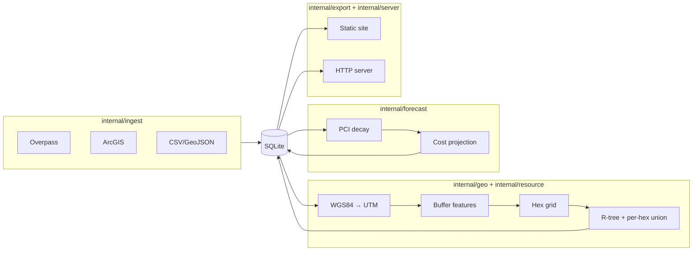
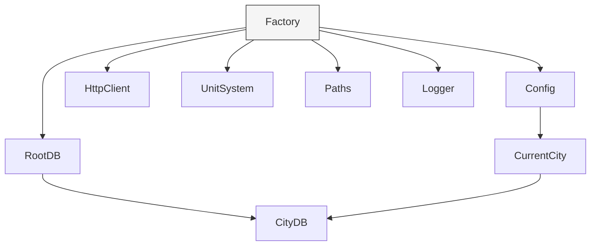
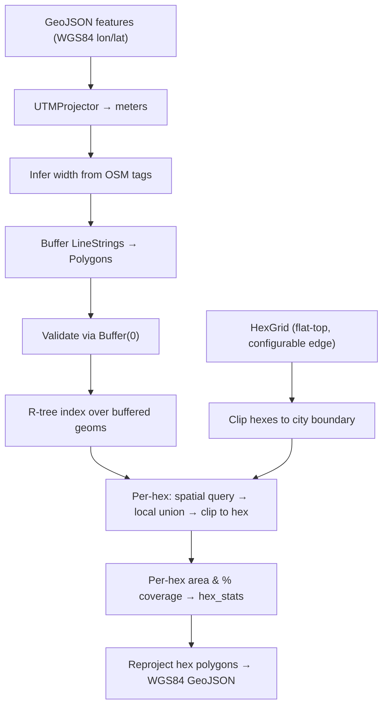
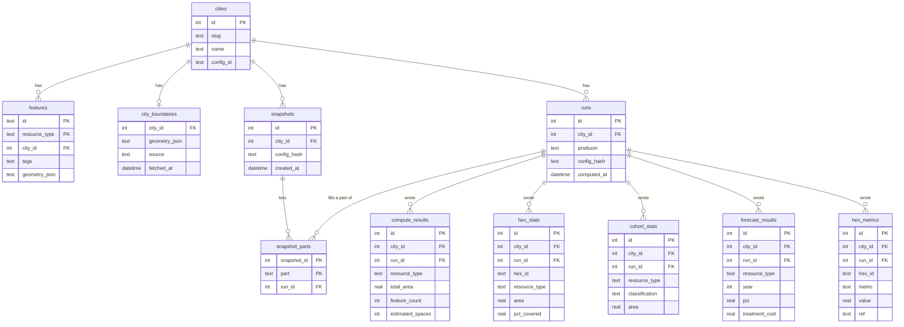

# Architecture

## Data pipeline

## Factory DI

Most dependencies are lazy-initialized behind `sync.OnceValues` closures in the `Factory` struct. The exception is `Logger`, which is constructed eagerly because its handler is cheap and the level is mutated through a shared `LogLevel *slog.LevelVar`.

Commands receive a `*Factory` and call only the accessors they need. The root command's `PersistentPreRunE` wires the `--city/-c` and `--units` flags into `CurrentCity` and `UnitSystem` before subcommands are added, so flag-aware overrides take precedence over per-city and top-level config. Multi-city commands use `cmdutil.ForEachCity`, which builds a city-scoped factory per iteration and silently skips cities with no results.

## Geometry pipeline

All area math happens in projected (meter) coordinates, never in degrees.

Roads: width inferred from `width` tag, `lanes` count, or classification defaults, plus parking lane addon.
Parking: polygons used directly; each lot also gets an estimated space count (`capacity` tag, else area / 30 m², × levels for garages) apportioned onto hexes by area fraction (`resource.EstimateParkingSpaces`, `geo.ComputeHexWeightedShares`). The city total is `compute_results.estimated_spaces`; the per-hex shares are `hex_metrics` rows under `parking_spaces_all` / `parking_spaces_city` (`resource.SpacesMetricKey`, deliberately unregistered) written by the same parking run as the coverage, which the exporter joins back into `hexgrid.geojson`'s per-hex `spaces`.
Sidewalks: buffered like roads with sidewalk-specific width defaults.

Service coverage (`pvmt services`, `internal/services`) runs beside the pavement passes rather than through them: facilities (`facility-<service>` features, OSM points collapsed from nodes/buildings) are routed from over a graph built from the stored roads (one source per city, vertices keyed by shared coordinates, edges costed by posted or class speed, oneway honoured), and each hex's response seconds land in the generic `hex_metrics` table (`internal/hexmetric` registry, key `fire_response_s`) under the service's own run (part `service:fire`). Facilities and hex centres snap to the nearest point along a road segment, not just a vertex. The exporter writes stored metrics (fire coverage, census population) from the resolved snapshot as the optional `hex-metrics.json`; a producer rerun that stored nothing commits an empty run, so an older run's rows never resurface; the dashboard's "Color by" mode paints any registered metric from its scale, so a new metric is a registry entry and a producer, not new client code.

Every hex coloring goes through that registry, including the pavement ones. Coverage %, paved area, parking spaces and est. year-1 cost are *derived* specs (`internal/hexmetric/builtin.go`): each declares how to combine the per-resource values in `hexgrid.geojson` (`sum` over the toggled resources, optionally capped, or a `ratio` of that sum over a stored metric). The exporter ships derived specs once in the page config and writes only stored metrics to `hex-metrics.json`; the dashboard resolves the active spec into one per-hex value and paints it with one expression, legend and tooltip path. `hexgrid.geojson` (v4) carries every hex of the clipped grid, so stored metrics can paint hexes with no pavement rows. Pavement storage itself is unchanged: `hex_stats` stays the pavement compute's table (area and % covered), feeding forecast, game seeds and cost; only the per-hex parking spaces ride in `hex_metrics`.

Population (`pvmt census`, `internal/population`) is a second metric producer. 2020 Census blocks are stored as `layer-census-blocks` features (`layer-<name>` is the convention for attribute polygons, like `facility-<service>` for points). Each block's POP100/HU100 counts are spread onto the hexes by area overlap (`geo.ComputeHexWeightedSharesN`). The results are stored as `population`, `housing_units` and `population_per_km2` metrics. Per-resident ratios are derived specs over the stored population. Both producers set up through `compute.LoadMetricTarget`, which resolves the projection and the clipped grid the pavement passes use (so hex ids line up). Neither depends on a roads compute: coverage routes over the road features, and population over the census features.

Facilities and census blocks are *own-sourced* (`resource.OwnSourced`): each comes from one fixed source (Overpass, TIGERweb) whatever the city's `overpass` / `arcgis_url` settings. `ingest.SourcesFor` resolves that source, and `pvmt gc`'s stale-source sweep only touches the pavement types in `resource.All`. A new own-sourced type therefore needs no special case in either place. TIGERweb is reached through `ingest.ArcGISQuery`, the generic ArcGIS paging and completeness core that the roads centerline source also uses.

## Database schema

Single file at `~/.local/share/pvmt/pvmt.db`. WAL mode. All tables scoped by `city_id`.

## Design decisions

**Metric internals.** All areas are stored in square meters. The `--units` flag and `[display].units` config control presentation only.

**JSON conventions.** Every JSON document pvmt emits — CLI `--json` output, the HTTP API, the exported site files, `window.PVMT_CONFIG`, the game and WASM payloads — shares one vocabulary, so a key reads the same everywhere and needs no docs to interpret:

- Keys are `snake_case`. A value has one name across every surface (forecast.json's `annual_need` is the CLI's `annual_need`).
- Timestamps end in `_at` and are RFC3339 UTC at second precision; calendar dates end in `_date`.
- A plural noun is a collection (list or map); an integer count of entities ends in `_count`. Quantities in a unit keep their noun (`estimated_spaces`, `oil_barrels`).
- Values are in canonical units and the UI converts for display: areas in m² (no unit suffix), money in dollars, durations in seconds (suffix `_s`), rates carry their unit (`cost_per_sqm`).
- Proportions are fractions in 0..1, never percentages. A part-of-whole proportion ends in `_share` (`paved_share`, `within_threshold_share`); signed relative ratios (`funding_gap`, `residual`) keep plain names.
- Positions are `[lon, lat]` arrays and extents are `bbox: [west, south, east, north]`, both in GeoJSON order. (`pvmt.toml` and the Go internals keep Overpass's `[south, west, north, east]`; the exporter reorders at the boundary.)
- `city` holds the slug; the display name is `name`.
- A value that does not apply is omitted — never `null`, never a 0 sentinel.
- Scope values are `"city"` (city-maintained features) and `"all"` (every jurisdiction).

Exempt: upstream formats (Overpass, ArcGIS, Nominatim, GeoJSON keys), the on-disk HTTP cache entries, `pvmt.toml` keys, the hand-curated `pkg/cmd/validate/reference.json`, and the deliberately short per-hex keys in the large hexgrid and play-board arrays (`area`, `share`, `spaces`, `city_same`, `k`, file version `v`). Struct tags are checked by `TestJSONTagsSnakeCase` and CLI field lists by `TestJSONFields_SnakeCase`.

**Runs and snapshots.** A *run* is one producer's output for one city: the roads, parking or sidewalks compute, the combined pass, each resource's forecast (`forecast:<resource>`), service coverage (`service:<name>`) or census. Every result row carries the `run_id` that wrote it, and runs are immutable. A *snapshot* is the city's complete computed state: a manifest in `snapshot_parts` naming one run per part. Every read resolves exactly one snapshot, the pinned id or else the newest for the current config hash, and reads only that snapshot's runs. `pvmt export` and `pvmt serve` pin each city to its newest snapshot once, at the start (`CityEntry.PinCurrentSnapshot`), so a compute that commits meanwhile cannot mix two snapshots into one city's files; `?snapshot=N` overrides the pin per request. Export refuses a city whose current snapshot holds no pavement compute (only coverage or census), which is what a metric-only command leaves right after a config edit.

Each command assembles a `db.Draft` and commits it as **one** snapshot: the newest snapshot for the same config hash, with only the parts the command produced swapped in. So a recompute affects only what it recomputes. `pvmt roads compute` swaps in a new roads run and reruns the roads forecast, since that is derived from the roads compute, in the same snapshot, and fire coverage and population carry over untouched. `pvmt all compute` commits one snapshot per city for all of its steps; a step that fails leaves its part as it was. A producer whose rerun reaches nothing (coverage that reaches no hex) commits an empty run, and one with nothing to work from (no features, no stations, no census blocks, `census = false`) drops its part; either way the old result is no longer published. A commit that would not change the manifest writes no snapshot, and no snapshot is ever empty. Nothing carries across config hashes, because hex ids from another grid would land on the wrong hexes; a config edit means recomputing. Uncommitted runs are invisible: a cancelled or failed command discards its runs, and `pvmt gc` sweeps any left behind by a crash once they are a day old (`db.OrphanRunGrace`; one city of `all compute` can legitimately hold an uncommitted run for hours). Write transactions take SQLite's lock up front (`_txlock=immediate`) and a commit retries while another process holds it, so two processes computing at once wait for each other rather than fail. Known limit: a command's draft reads the snapshot that was newest when it ran, so a `pvmt forecast` racing a `pvmt roads compute` can commit a forecast of the older roads on top of the newer one. `pvmt snapshots prune` / `rm` delete manifests and then every run no surviving snapshot references, so every snapshot that remains reads exactly what it did.

**Schema generations.** `001_init.sql` creates the current schema and stamps `PRAGMA user_version` with the generation (`schemaGeneration` in `internal/db/migrations.go`). Ordinary changes are additive numbered migrations within a generation. A breaking squash bumps the generation, and pvmt refuses a database from any other generation rather than converting it (see [`#incompatible-database`](troubleshooting.md#incompatible-database)).

**WASM build order.** The forecast WASM binary is embedded via `go:embed`. It must be compiled (`make wasm`) before building the main binary; the Makefile enforces this dependency. The embed is of the `internal/export/wasm/` directory, whose only tracked file is a README, so a build without the generated WASM still compiles: that is what `go install …@version` produces, since the module zip carries only tracked files. Such a binary runs every command except `export`, `serve` and `check-site`'s asset check, which fail with `export.ErrNoWasm` and a hint.

**HTTP caching.** API responses are disk-cached at `~/.cache/pvmt/http/` with a 24-hour TTL. Both GET (Nominatim, ArcGIS) and POST (Overpass) requests are cached — the cache key folds in the request method and body, so Overpass query POSTs are keyed by their `data=` payload rather than colliding on a shared URL. Use `--force` on ingest to bypass. A TTL of 0 disables the cache entirely (no read, no conditional revalidation).

The cache has no online eviction — putting a directory scan in front of every request would cost more than it saves — so entries accumulate for the life of the install, including keys that will never be requested again (a changed bbox, a city dropped from `pvmt.toml`). Eviction is an explicit offline sweep: `pvmt cache prune` removes entries past an age ceiling, evicts oldest-first until the total is under a size ceiling, and sweeps half-written pairs left by a crash between the body and metadata writes. An entry's age is the newer of its two files, because a 304 revalidation rewrites only the `.meta`. It plans the sweep, prints it, and confirms before deleting (`--yes` to skip, `--dry-run` to plan only) — evicting is cheap for the user's data but costs a re-download from community-funded endpoints. It reads no config and opens no database, so it still works when either is broken — which is why it is its own command group rather than part of `pvmt gc`.

**Overpass splitting.** Large Overpass queries auto-split into quadrants (up to depth 3 / 64 requests) and deduplicate at boundaries.

**Forecast model.** Exponential PCI decay: `PCI(t) = PCI_0 * exp(-k*t)`. Per-classification decay rates default to FHWA national averages. Costs are projected via configurable PCI-to-cost tiers. Pavement growth is modeled as linear annual increase.

**Solvency methodology.** Three roads-only metrics summarize funding adequacy, all computed on a worst-first, current-budget scenario (`internal/forecast/solvency.go`):

- **Treatment cycle.** Real pavement is treated on a multi-year cycle (~10–14 yr): each year only ~1/N of the network is scheduled, not the whole network. `Simulate` models this by gating annual need to `full-network cost / N` (`treatment_cycle_years`, default 12). Without it the model would price the entire network every year (an implicit 1-year cycle), overstating the hold-steady budget 3.6×–9.6× (see `docs/validation.md` §5). Because gating is a pure `1/N` rescaling in dollar-space, the PCI trajectory is unchanged and `break_even_budget` scales exactly as `1/N`.
- **`break_even_budget`** — the smallest constant annual budget whose final deferred backlog ≈ 0: the budget to fund the network's annually-scheduled treatment slice, i.e. keep pace with the cycle. Budget-independent of `current_budget`; always computed for roads.
- **`insolvency_year`** — the first year cumulative deferred backlog reaches one full treatment cycle of work (`cycleYears × year-1 need`), i.e. the city has deferred an entire network's worth of treatment. A do-nothing network crosses at ~N years; a city funding fraction f of each slice crosses at ~N/(1−f), so well-funded cities omit it ("solvent through horizon"). On the funded side **`funding_gap` is the primary discriminator**, by design.
- **Cost basis.** Solvency dollars use the cost tiers' *bare-construction* basis (validation §3), not loaded municipal program cost (which runs ~2–3× higher); they are an order-of-magnitude planning figure, not a budget line item. The default tiers and cycle are calibration inputs — override per city when local figures differ.

**TUI progress.** `internal/tui` is a single bubbletea `StepModel` rendering a phase checklist, log tail, warnings panel, and progress bar in one view — spinner frames and bar are inline, not standalone widgets, so it carries zero extra deps. (This deviates from the byob-progress.3 recipe's `bubbles/spinner` + `schollz/progressbar` behind a `Progress` interface, which earns its ceremony only for isolated ad-hoc progress events, not an already-unified program.)
