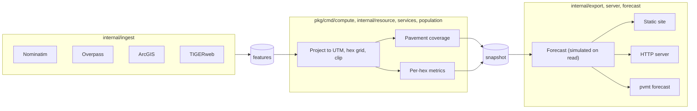
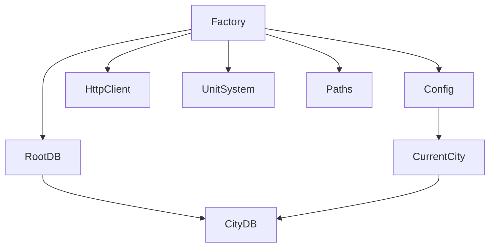
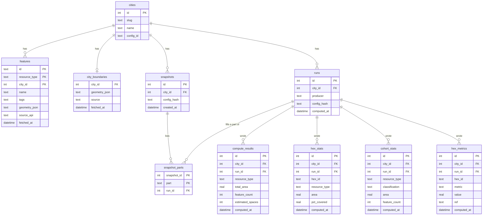

# Architecture

`pvmt` is a pipeline with a database in the middle. **Ingest** fetches
features for each configured city from upstream services and stores them.
**Compute** projects those features onto a hex grid, and each producer stores
its results as an immutable *run*, grouped into a *snapshot*. **Read**
commands work only from a snapshot: export, serve and `pvmt forecast`. They
simulate the forecast when they run, so nothing forecast-related is ever
stored. This page explains how each stage is built and why. What the models
*mean* (decay, cost, solvency, fire response, population) is in the
[methodology](../internal/export/docs/methodology.md), and every setting is in
[configuration.md](configuration.md).

## Commands and the Factory

Commands follow the `gh` CLI's shape: each has an Options struct, a
constructor and a `Run` function. Each receives a `*cmdutil.Factory`, and tests
swap in a `runF` to capture the options. The Factory holds lazy
`sync.OnceValues` accessors, so a command pays only for what it touches:
`--version` opens no config and no database. `IOStreams`, `Prompter` and
`Logger` are the eager exceptions, because they are cheap to build.

The root command's `PersistentPreRunE` applies `--city/-c`, `--units` and the
log level before any subcommand runs, so a flag beats per-city and top-level
config. Multi-city commands iterate with `cmdutil.ForEachCity`, which builds a
city-scoped Factory per city.

## Geometry

All area math happens in projected meters, never in degrees. Each city is
projected to the UTM zone of its bbox centre. A road centerline is buffered by
a width inferred from its OSM tags: the `width` tag, else `lanes`, else a
class default, plus any parking lanes. Sidewalks are buffered the same way
with their own defaults. Parking lots are already polygons. Buffered
geometries go into an R-tree. The city is tiled with flat-top hexes of the
configured edge and clipped to the city boundary. For each hex, the features
it touches are unioned and clipped to the hex, which gives its area and
percent covered (`pct_covered`, 0–100) in `hex_stats`. Hex polygons are
projected back to WGS84 only for output.

Geometry is pure Go, `peterstace/simplefeatures`. Several of its constructors
have non-obvious signatures (`NewLineString` returns one value,
`Envelope.MinMaxXYs()` returns `(XY, XY, bool)`), so mirror the existing
`internal/geo/` call sites rather than guessing.

Large Overpass queries split into quadrants, up to depth 3 (64 requests), and
deduplicate features at the seams.

## Per-hex metrics

Pavement coverage lives in `hex_stats`. Every other per-hex value lives in the
generic `hex_metrics` table, keyed by a metric registered in
`internal/hexmetric`. Two producers write registered metrics:

- **Fire response.** `internal/services` routes from fire stations over a
  graph built from the stored roads.
- **Population.** `internal/population` apportions 2020 Census blocks onto
  hexes by area.

The parking compute also stores its per-hex space estimates in `hex_metrics`.
They sit under deliberately unregistered keys (`resource.SpacesMetricKey`),
and the exporter folds them back into `hexgrid.geojson`.

Both metric producers resolve, through `compute.LoadMetricTarget`
(`pkg/cmd/compute`), the same projection and clipped grid the pavement passes
use, so hex ids line up. No producer reads another producer's stored results.

The dashboard paints every coloring from that registry. Stored metrics ship in
`hex-metrics.json`. *Derived* metrics are registered beside
them: coverage %, paved area, parking spaces and year-1 cost in
`internal/hexmetric/builtin.go`, and the per-resident ratios in
`internal/population`. Each declares how to combine the per-resource values in
`hexgrid.geojson`, and the browser resolves it. A new coloring is therefore a
registry entry, plus a producer if it needs stored data, and no client code.
`hexgrid.geojson` carries every hex of the clipped grid, so a stored metric can
paint a hex that has no pavement.

Fire stations and census blocks are *own-sourced* (`resource.OwnSourced`):
each comes from one fixed upstream, whatever the city's `overpass` /
`arcgis_url` settings. `ingest.SourcesFor` resolves the source, and `pvmt gc`'s
stale-source sweep covers only the pavement types in `resource.All`, so a new
own-sourced type needs no special case in either. TIGERweb and the ArcGIS
centerline source share one paging and completeness core, `ingest.ArcGISQuery`.

## Database

The database is a single SQLite file in the data directory (see
[configuration.md](configuration.md#files-and-directories)), opened in WAL
mode. Every table carries a `city_id`, except `snapshot_parts`, which hangs
off its snapshot.

`cities` is unique on `(slug, config_id)`, not on slug alone. That keeps two
configs that happen to define the same city apart, while a city pulled in
through `[[include]]` resolves to its declaring config's row (see
[Config identity](configuration.md#config-identity-config_id)).

`001_init.sql` creates the schema, and `checkGeneration`
(`internal/db/migrations.go`) stamps a fresh database's `PRAGMA user_version`
with `schemaGeneration`.
Changes within a generation are numbered migrations. A breaking change bumps
the generation, and pvmt refuses a database from any other generation rather
than converting it (see
[troubleshooting](troubleshooting.md#incompatible-database)).

## Runs and snapshots

A *run* is one producer's output for one city. The producers are the roads,
parking or sidewalks compute, the combined pass, `service:<name>` and census.
Every result row carries its `run_id`, and runs are immutable. A *snapshot* is
the city's complete computed state: a manifest in `snapshot_parts` that names
one run per part. Every read resolves exactly one snapshot and reads only its
runs. That snapshot is the pinned id, or else the newest one under the city's
current config hash. `pvmt export` and `pvmt serve` pin each city's snapshot
once at startup (`CityEntry.PinCurrentSnapshot`), so a compute that commits
meanwhile cannot mix two snapshots into one city's files. `?snapshot=N`
overrides the pin per request.

Each command builds a `db.Draft` and commits it as one snapshot: the newest
snapshot under the same hash, with only the parts the command produced swapped
in. `pvmt roads compute` replaces the roads part, and fire coverage, population
and the other resources carry over. `pvmt all compute` commits one snapshot
per city covering all of its steps. A failed step leaves its part as it was.

A rerun that reaches nothing still commits, as an empty run. A producer with
nothing to work from drops its part. Either way the older result stops being
published. A commit that would not change the manifest writes nothing, and no
snapshot is ever empty.

Nothing carries across config hashes, because hex ids from another grid would
land on the wrong hexes. Export refuses a city whose snapshot has no pavement
compute. It warns when a part the city had under earlier settings has not yet
been produced under the current ones.

Uncommitted runs are invisible. A cancelled or failed command discards its
runs, and `pvmt gc` sweeps any left by a crash once they are a day old
(`db.OrphanRunGrace`). The grace is that long because one city of `pvmt all
compute` can legitimately hold an uncommitted run for hours. Write
transactions take the lock up front (`_txlock=immediate`) and wait out SQLite's
busy timeout. A snapshot commit then keeps retrying for up to two minutes
(`commitBusyBudget`), so two concurrent computes wait for each other instead of
failing. No producer reads
another's results, so two commands committing in either order each swap in
only their own parts. `pvmt snapshots prune` and `rm` delete manifests, then
every run no surviving snapshot references.

## Config hash

Snapshots are keyed by `Config.CityHash` (`internal/config/hash.go`). It is a
16-hex-character sha256 over a canonical encoding of only the resolved inputs
that change a stored result (`computeInputs`), plus a hand-bumped
`ComputeEpoch` for code changes. Resolved means defaults, `[[include]]`
flattening and env overrides are applied first. Because the hash depends only
on what a city resolves to, an included city hashes as its source config does
when both resolve the same inputs (see
[Config identity](configuration.md#config-identity-config_id)). When they
differ, `SourceDivergence` names the setting.

`TestComputeInputs_EveryFieldClassified` forces every new config field to be
classified. Which settings are in the hash is stated once, for users, in
[configuration.md](configuration.md#snapshots-and-the-config-hash). The rules
for contributors are in
[CONTRIBUTING.md](../CONTRIBUTING.md#changes-that-affect-stored-results).

## JSON conventions

Every JSON document pvmt emits shares one vocabulary, so a key reads the same
everywhere. That covers CLI `--json` output, the HTTP API, the exported site
files, `window.PVMT_CONFIG`, and the game and WASM payloads.

- Keys are `snake_case`, and a value has one name across every surface
  (forecast.json's `annual_need` is the CLI's `annual_need`).
- Timestamps end in `_at` and are RFC3339 UTC at second precision. Calendar
  dates end in `_date`.
- A plural noun is a collection. An integer count of entities ends in
  `_count`. A quantity in a unit keeps its noun (`estimated_spaces`).
- Values are in canonical units, and the UI converts them for display:
  - areas in m², with no unit suffix;
  - money in dollars;
  - durations in seconds, suffixed `_s`;
  - rates carry their unit (`cost_per_sqm`).
- Proportions are fractions in 0..1. A part-of-whole proportion ends in
  `_share`. Signed ratios (`funding_gap`) keep plain names.
- Positions are `[lon, lat]`, and extents are `bbox:
  [west, south, east, north]` (GeoJSON order). `pvmt.toml` and the Go
  internals use Overpass's `[south, west, north, east]`, and the exporter
  reorders at the boundary.
- `city` holds the slug. The display name is `name`.
- A value that does not apply is omitted, never `null` or a 0 sentinel.
- Scope values are `"city"` (city-maintained) and `"all"` (every
  jurisdiction).

A few formats are exempt:

- upstream formats;
- HTTP cache entries;
- `pvmt.toml` keys;
- `pkg/cmd/validate/reference.json`;
- the deliberately short per-hex keys in the large hexgrid and play-board
  arrays (`area`, `share`, `spaces`, `city_same`, `k`, and the file version
  `v`).

`TestJSONTagsSnakeCase` and `TestJSONFields_SnakeCase` enforce the
conventions.

A command that prints rows takes `--json <field,...>`
(`cmdutil.AddJSONFlags`) and prints an array of row objects. A command that
prints one document takes a bare `--json` (`cmdutil.AddDocumentJSONFlags`):
export's manifest and validate's report. `--jq` and `--template` need `--json`
and see exactly what it prints. `--jq` runs once over the whole output, and
`--template` runs once per row, or once over the document.

## Design decisions

**Metric internals.** Areas are stored in square meters and money in dollars.
`--units` and `[display].units` change presentation only.

**Embedded WASM.** The forecast runs in the browser as the same Go forecast
code compiled to WASM (`cmd/wasm/pvmt`), so the site and the CLI run one
model. The binary embeds it from `internal/export/wasm/`, whose only
tracked file is a README, so a build without the generated WASM still
compiles. That keeps `go install` working, at the cost of the commands that
ship the forecast (see
[troubleshooting](troubleshooting.md#export-errnowasm)). The build order is in
[CONTRIBUTING.md](../CONTRIBUTING.md#build-test-lint).

**Outbound HTTP cache.** Upstream responses are disk-cached for 24 hours in
the cache directory. That includes Overpass POSTs, because the key folds in
the method and body. The cache has no online eviction: a directory scan in
front of every request would cost more than it saves. Eviction is the
explicit offline sweep `pvmt cache prune` (see
[troubleshooting](troubleshooting.md#disk-usage-the-http-cache-keeps-growing)).
It is a command group of its own rather than part of `pvmt gc`, because
reclaiming disk must not depend on the config or the database. An entry's age is the newer of its body and
`.meta` files, because a 304 revalidation rewrites only the `.meta`.

**TUI progress.** `internal/tui` is one bubbletea `StepModel` that renders the
phase checklist, log tail, warnings and progress bar in a single view, with no
widget dependencies.
